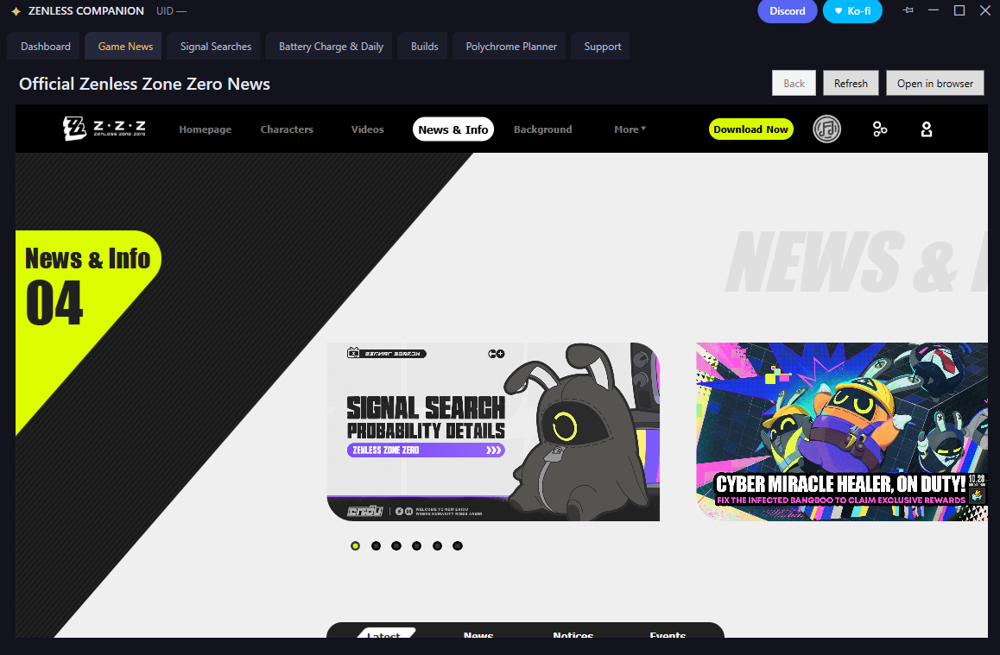
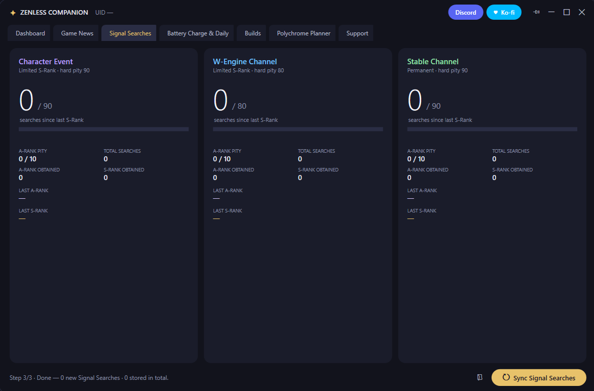
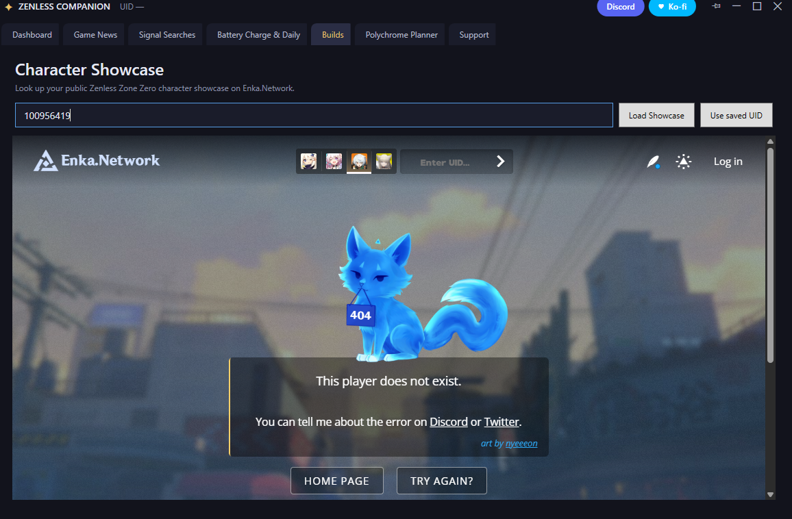

# Zenless Companion

Zenless Companion is an unofficial Windows desktop companion for Zenless Zone Zero. It tracks Signal Search history and pity for Character Event, W-Engine Channel, and Stable Channel, and stores app data locally.

## Features

- **Signal Search tracking:** Read Signal Search history from the game's local WebView cache and show pity and rarity counts.
- **Polychrome planner:** Estimate featured Character Event outcomes using saved pity, guarantee state, Polychromes, and Encrypted Master Tapes.
- **HoYoLAB tools:** Sign in through the embedded browser to view account notes and public character showcases.
- **What's New:** Pull release notes from the Zenless Companion release service at startup, refresh them on demand, and receive live release notifications.
- **Official news:** Browse Zenless Zone Zero news.
- **Privacy-conscious:** No app account or analytics. Signal Search history, settings, and WebView profiles are stored locally.

This project is community-made and is not affiliated with or endorsed by COGNOSPHERE / HoYoverse. Zenless Zone Zero is a trademark of its respective owner.

## Screenshots

### Game News

Browse the official Zenless Zone Zero news page in the app.



### Signal Searches

Review pity and A-Rank/S-Rank results across Character Event, W-Engine, and Stable Channels.



### Battery Charge and Dailies

View Battery Charge, daily and weekly progress, and expeditions from HoYoLAB.


### Builds

Look up a public Zenless Zone Zero character showcase by UID.



### Polychrome Planner

Estimate featured Character Event chances using Polychromes, Encrypted Master Tapes, pity, and guarantee state.


## First-time Signal Search sync

1. Launch Zenless Zone Zero and open **Signal Search > View Details**. Wait for the history page to load.
2. Open Zenless Companion and select **Sync Signal Searches**.
3. If the game folder is not detected, select the installation folder containing `ZenlessZoneZero_Data` (or `ZenlessZoneZero.exe`).
4. Signal Search-history links expire. If sync reports an expired link, reopen **Signal Search > View Details** in-game and sync again.

Sync reads the game's local cache without modifying it or interacting with the game process. Treat the temporary Signal Search-history link as private; anyone who has it may be able to access the history while it remains valid.

## Install

When a release is available, download `ZenlessCompanionSetup.exe` from the [latest GitHub Release](https://github.com/greyfoxdevelopment/GFDev-Zenless-Companion/releases/latest). The installer downloads `ZenlessCompanion.exe` and its SHA-256 checksum from the same release and verifies the executable before installation.

The installer is self-contained and does not require the .NET runtime. Embedded pages require the Microsoft Edge WebView2 Runtime, which is included with most Windows installations.

## Build from source

Requirements: Windows 10/11 x64 and the .NET 8 SDK.

```powershell
dotnet run --project src\ZenlessCompanion.csproj -c Release
dotnet build Setup\ZenlessCompanionSetup.csproj -c Release
```

See [instructions.txt](instructions.txt) for data locations, troubleshooting, and release steps.

## Privacy

Data is stored under `%LOCALAPPDATA%\ZenlessCompanion`. HoYoLAB cookies are kept in the local WebView2 profile and used only for requests you initiate. The app contacts HoYoverse/HoYoLAB for game features, GitHub for update downloads and checksum verification, and Ko-fi when its support tab is opened. Release metadata and notifications are provided by the Zenless Companion release service. Each service may process request metadata under its own privacy policy.

The app checks for release updates at startup, listens for live release notifications, and retries periodically while running. Update executables and SHA-256 checksums are downloaded from GitHub only after confirmation. The checksum detects corruption or mismatch but is not an independent signature against compromise of the release account.

## License

Released under the MIT License; see [LICENSE](LICENSE).
